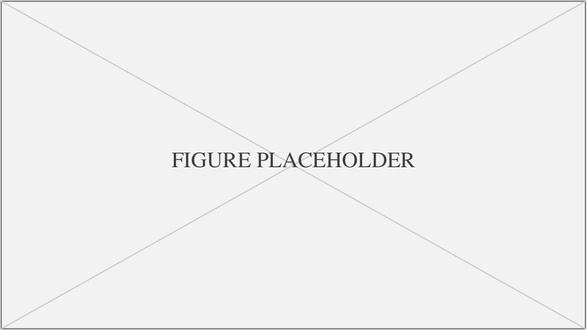

**文件編號：** 〔報告編號〕
**版本：** v0.1
**日期：** 〔YYYY-MM-DD〕
**狀態：** Draft
**報告性質：** 研究
**標題：** 〔報告標題〕
**作者：** 〔作者〕
**適用標準：** PXA-STD-SP-001／PXA-STD-SP-002

> 本檔是 `PXA-SP-template.dotx` 的內容來源。改完後執行
> `python scripts/md2docx.py templates/PXA-SP-template.md -o templates/PXA-SP-template.dotx`
> 重建範本。樣式（字型、行距、表格框線）改在 .dotx 的樣式裡，不寫在本檔。

---

## 封面（Cover Page）

**〔報告系列，例：PXA Technical Report〕**　　〔報告編號〕

# 〔報告標題〕

| 項目 | 內容 |
|------|------|
| 報告編號 | 〔報告編號〕 |
| 版本 | 〔v0.1〕 |
| 日期 | 〔YYYY-MM-DD〕 |
| 狀態 | 〔Draft〕 |
| 安全等級 | 〔安全等級〕 |

**工具版本**

| 工具 | 版本 |
|------|------|
| 〔工具或標準名稱〕 | 〔版本〕 |
| 〔工具或標準名稱〕 | 〔版本〕 |

## 書名頁（Title Page）

**〔報告系列〕**　　〔報告編號〕

# 〔報告標題〕

| 項目 | 內容 |
|------|------|
| 作者 | 〔作者〕 |
| 單位 | 〔單位〕 |
| 專案 | 〔專案名稱〕 |
| 階段 | 〔專案階段〕 |
| 日期 | 〔YYYY-MM-DD〕 |
| 版本 | 〔v0.1〕 |

## 書名頁背面（Back of Title Page）

**致謝**
〔致謝對象；無則填「無。」〕

**免責聲明**
〔免責聲明：本報告之用途、內容所反映之時間點，以及使用者應自行確認之事項。〕

**可用性**
〔本報告依文件發行授權第 II 部分之安全等級發行，並說明取得方式。〕

**審查等級**
〔本報告已完成或尚未完成之審查。〕

**與標準之偏離**
〔逐項列出與適用標準之偏離及理由；無則填「無。」〕

## 文件發行授權（Document Availability Authorization）

| 欄位 | 內容 |
|------|------|
| **§I 文件識別** | |
| 文件標題 | 〔報告標題〕 |
| 報告編號 | 〔報告編號〕 |
| 作者 | 〔作者〕 |
| 階段 | 〔專案階段〕 |
| 版本 / 日期 | 〔v0.1〕 / 〔YYYY-MM-DD〕 |
| 所屬單位 | 〔單位〕 |
| 專案 | 〔專案名稱〕 |
| **§II 分類與發行** | |
| 安全等級 | □ 公開　□ 內部　□ 限制 |
| 出口管制 | □ 不涉及　□ 需審查　□ 涉及管制（類別：____） |
| 發行範圍 | □ 專案團隊　□ 組織內部（含承包商）　□ 須經核准權責主管核准 |
| 智慧財產 | □ 不涉及　□ 專利揭露　□ 版權內容　□ 商業機密 |
| **§III 作者聲明** | |
| 聲明 | □ 不含受限內容，可依上述分類發行　□ 含受限內容，已於 §II 標示 |
| 作者 / 日期 | __________ / __________ |
| **§IV 審查與核准** | |
| 技術審查 | □ 核准　□ 退回修正　□ 不核准 — 簽名/日期：__________ |
| 管理審查（PM） | □ 核准　□ 退回修正　□ 不核准 — 簽名/日期：__________ |
| 最終核准（核准權責主管） | □ 核准　□ 退回修正　□ 不核准 — 簽名/日期：__________ |
| **§V 處置** | |
| 核准後處置 | □ 存入專案文件庫　□ 發送至客戶　□ 公開發佈　□ 其他：____ |
| 存檔編號 | __________ |

## 文件資訊（Document Information）

| 項目 | 內容 |
|------|------|
| 報告性質 | 〔研究／設計／測試，可並列，例：設計＋測試〕 |
| 審查等級 | 〔同儕審查〕 |
| 可取得性 | 〔依文件發行授權第 II 部分之安全等級發行〕 |
| 摘要 | 〔一段話之摘要，與「摘要」一節一致，不含引用與公式。〕 |
| 關鍵字 | 〔關鍵字 1, 關鍵字 2, 關鍵字 3〕 |

## 修訂紀錄（Revision History）

| 版本 | 日期 | 作者 | 變更說明 |
|------|------|------|----------|
| v0.1 | 〔YYYY-MM-DD〕 | 〔作者〕 | 〔初稿〕 |
| v1.0 | 〔YYYY-MM-DD〕 | 〔作者〕 | 〔變更說明〕 |

## 摘要（Abstract）

〔摘要一段，200 至 300 字：研究對象、方法、主要結果（含數字）、適用範圍。不放引用、公式與縮寫首現以外之括號說明。〕

## 符號表（Nomenclature）

| 符號 | 定義 | 單位 |
|:----:|------|:----:|
| $x$ | 〔狀態量之定義〕 | 〔單位〕 |
| $k$ | 〔係數之定義〕 | – |
| $\tau$ | 〔時間常數之定義〕 | s |

縮寫：〔縮寫，全名；縮寫，全名。〕

## 1. 緒論（Introduction）

### 1.1 研究動機（Motivation）

〔內文樣式：標楷體 12 點、英數 Times New Roman、行距 1.5 倍、靠左對齊、黑色。直接在這裡打字，不要手動改字型或顏色。〕

〔第二段。段與段之間的距離由樣式控制，不要用空白行隔開。〕

### 1.2 文獻回顧（Literature Review）

〔依文獻層級組織：現況、缺口、本報告之定位。〕

### 1.3 研究目標（Objectives of Study）

本報告回答下列問題：

1. 〔問題一。〕
2. 〔問題二。〕

### 1.4 主要貢獻（Principal Contributions）

1. 〔貢獻一，對應結論 [C-1]。〕
2. 〔貢獻二，對應結論 [C-2]。〕

### 1.5 章節安排（Organization of the Document）

〔第 2 章說明……。第 3 章呈現……。附錄 A 為……。〕

## 2. 理論與建模（Theory and Modeling）

### 2.1 節標題（Section Heading）

〔技術主體之章名與章數依報告性質決定，見附錄 B 之裁剪表：研究寫理論與建模；設計另加需求與設計基線、取捨研究；測試另加測試項目與通過準則、測試組態、偏差紀錄。〕

〔章標題用「標題 2」樣式，會自動從新的一頁開始；節用「標題 3」；小節用「標題 4」。〕

#### 2.1.1 小節標題（Subsection Heading）

〔公式獨立成行並置中，式號寫在式尾括號內，內文以「式 (2-1)」引用。公式之後說明各符號、來源與適用條件。〕

$$
\dot{x} = \frac{k\,u - x}{\tau}
\tag{2-1}
$$

其中 $x$ 為〔狀態量〕，$u$ 為〔輸入〕，$k$ 與 $\tau$ 為〔參數〕。

### 2.2 表格（Tables）

〔表標題在表格上方，樣式為 Table Caption；內文先提到表，表才出現。表格內文字用「無間距」樣式。〕

表 1　〔表標題〕

| 參數 | 值 | 單位 | 來源 | 信度 |
|------|----|------|------|------|
| $k$ | 〔1.00〕 | – | 〔來源文件與頁碼〕 | ★ |
| $\tau$ | 〔0.02〕 | s | 〔來源文件與頁碼〕 | ⚠ |
| 〔參數〕 | 〔值〕 | 〔單位〕 | 〔來源文件與頁碼〕 | ★ |

〔表格之後接續內文。〕

### 2.3 圖（Figures）

〔圖標題在圖的下方，樣式為 Image Caption；圖置中，寬度不超過版心。〕

{width=70%}

## 3. 結論（Conclusions）

### 3.1 結論（Conclusions）

**[C-1]** ★ 〔結論。〕適用條件：〔條件〕。限制：〔限制〕。

**[C-2]** ⚠ 〔結論。〕適用條件：〔條件〕。限制：〔限制〕。

### 3.2 建議（Recommendations）

〔後續工作與建議。〕

## 參考文獻（References）

1. 〔作者. 標題. 期刊或出版者, 年份. DOI 或文件編號.〕
2. 〔作者. 標題. 期刊或出版者, 年份. DOI 或文件編號.〕

## 附錄 A　引用文獻之逐字摘錄（Appendix A: Verbatim Excerpts）

| 引用位置 | 原文位置 | 原文摘錄 | 用途 |
|----------|----------|----------|------|
| 〔§2.1〕 | 〔p.3, Eq.(5)〕 | 〔"verbatim text from the source"〕 | 〔本報告如何使用〕 |

## 附錄 B　範本使用說明（交付前刪除本附錄）

本範本供手動編寫報告使用，版面與轉檔腳本產出者相同。使用步驟如下：

1. 以本範本開新文件，另存為「報告編號.docx」。
2. 把所有〔 〕內之文字換成實際內容；用不到的章節整節刪除。
3. 在頁尾按兩下，把〔報告編號〕與〔安全等級〕改成實際內容；改一次，全文各頁同步。
4. 交付前刪除本附錄，並確認封面只有一頁。

報告性質決定哪些章節必要。請在文件資訊頁填入報告性質，並依下表增刪章節；兼具兩種性質時必要章節取聯集。

| 章節 | 研究 | 設計 | 測試 |
|------|:----:|:----:|:----:|
| 前頁、摘要、緒論、結論、參考文獻 | 必要 | 必要 | 必要 |
| 文獻回顧 | 必要 | 可選 | 可省 |
| 理論與建模 | 必要 | 必要 | 可省，引用即可 |
| 需求與設計基線、取捨研究 | 可省 | 必要 | 可省 |
| 測試項目、通過準則、組態、偏差紀錄 | 可省 | 可選 | 必要 |
| 逐字摘錄附錄 | 必要 | 有引用即必要 | 有引用即必要 |

參數基線、合規矩陣、交接參數等表需要時另立附錄。

各種內容所用之樣式如下。請從「常用」索引標籤之樣式庫選用，不要手動改字型、字級或顏色。

| 內容 | Word 樣式 | 版面 |
|------|-----------|------|
| 章標題 | 標題 2（Heading 2） | 12 點粗體，英文字母全大寫，自動換頁 |
| 節標題 | 標題 3（Heading 3） | 12 點粗體 |
| 小節標題 | 標題 4（Heading 4） | 12 點粗體 |
| 內文 | 本文（Body Text） | 12 點，行距 1.5 倍，靠左 |
| 表格內文字 | 無間距（No Spacing） | 12 點，單行間距 |
| 表標題 | Table Caption | 置中粗體，在表格上方 |
| 圖標題 | Image Caption | 置中粗體，在圖下方 |

版面之其餘規則如下：

- **頁碼**：封面不編頁碼；書名頁起為小寫羅馬數字，書名頁本身計為 i 但不顯示；第 1 章起為阿拉伯數字，自 1 起算。這是以分節符號達成的，請勿刪除封面底部與第 1 章之前的分節符號。
- **新增表格**：複製本範本之範例表格再改內容，框線、表頭底色與重複表頭都會保留。代號、數值、單位等短欄置中，長文字欄靠左。
- **新增圖片**：圖片所在段落用 Captioned Figure 樣式，下一段用 Image Caption 寫圖標題。
- **公式**：以 Alt＋= 插入，獨立成行並置中，式號寫在式尾括號內。
- **顏色**：全文文字為黑色；表頭底色為淺灰。
